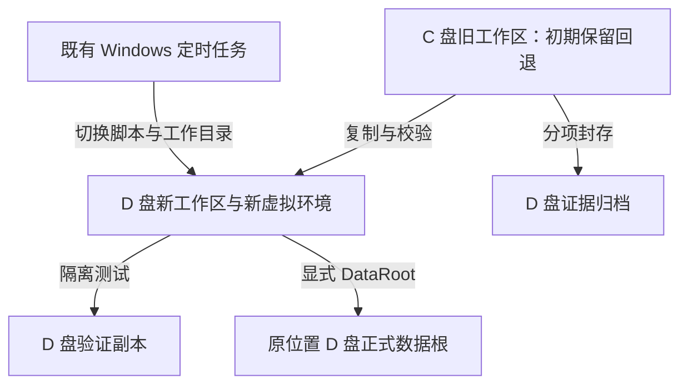
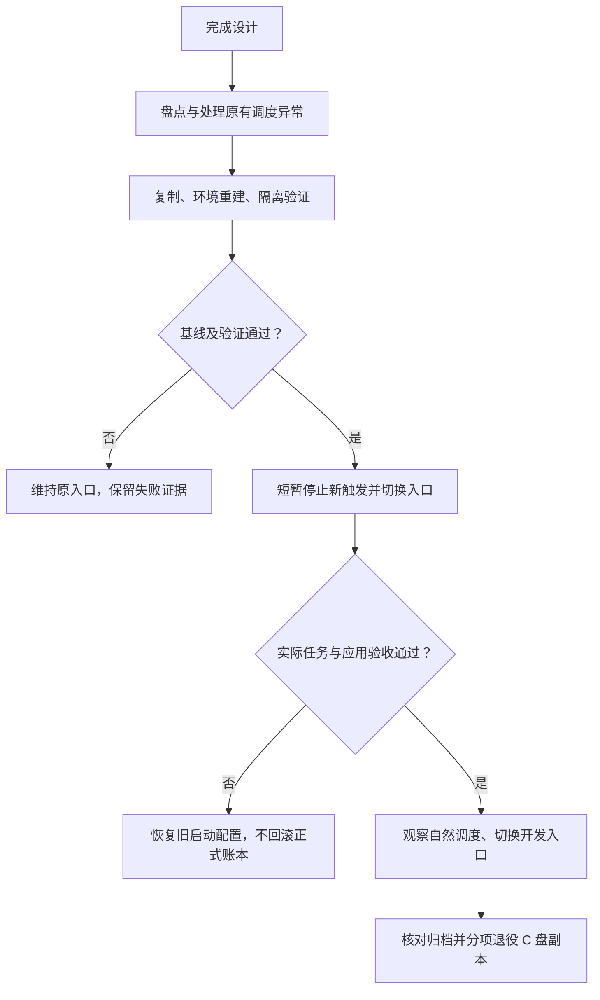

# Finance Lab C 盘至 D 盘迁移设计表

## Summary

把开发工作区、项目 Python 环境和今后的测试缓存迁到 D 盘；正式运行数据保留当前 D 盘位置。采用“复制并校验 → 重建环境 → 隔离验证 → 切换入口 → 观察定时运行 → 分项退役旧副本”的顺序。

本文为设计方案，尚未执行迁移。目录名称是建议值，执行前重新检查占用。本文中的机器路径是迁移目标配置；代码、测试和参考文档使用仓库相对路径。

## Problem Frame

项目开发目录仍位于 C 盘，正式日线数据已经位于 D 盘。计划任务通过 C 盘代码和虚拟环境访问 D 盘数据，因此只复制文件夹不足以完成切换。

2026-10-13 的只读核对结果如下。大小采用 1 GiB = 1,073,741,824 字节，与 Windows 常见的 GB 显示口径一致；统计的是文件逻辑长度。部分旧测试目录拒绝访问，链接未跟随，因此总量是已确认下限。

| 范围 | 已测大小 | 对迁移的影响 |
|---|---:|---|
| C 盘主项目 | 1.12 GiB | 包含开发环境、资料、历史数据及报告 |
| 其中 `.venv` 和 `smoke-venv` | 约 0.85 GiB | 在 D 盘重建；旧环境暂作回退依赖 |
| C 盘关联测试、打包和恢复目录 | 约 3.00 GiB | 逐目录分类；不能全部按缓存删除 |
| D 盘测试与缓存 | 约 2.08 GiB | 已在 D 盘，不计入 C 盘释放量 |
| D 盘正式运行根 | 约 12.56 MiB | 原地保留 |
| 已确认项目相关合计 | 至少 6.21 GiB | 其中 C 盘至少约 4.12 GiB |
| C / D 最新剩余空间 | 约 31.2 / 106.1 GiB | 会随其他程序变化，执行时刷新 |

这次规模统计覆盖主项目、同级 `finance-lab-*`、`profile-task3-*` 以及已知 D 盘任务目录，并非整机所有开发文件。以前的 15.8 GiB 是较早的 C 盘剩余空间读数，不能作为执行时容量。

### Current Baseline

| 项目 | 当前证据 | 执行要求 |
|---|---|---|
| Git | 分支 `codex/v1-quality-sprint`；HEAD `df000ae4e017b07238872c9ef0ee6b206dc06a0f`；比本地记录的上游领先 10 个提交 | 完整保留本地 `.git` 和未提交内容，不能只从 GitHub 重新克隆；不以此推断远端实时状态 |
| 工作树 | 普通 `.git` 目录，已列出的工作树只有当前项目 | 执行时再检查，不能把外置 Git 对象或新增工作树漏掉 |
| Python | `.venv/pyvenv.cfg` 为 Python 3.13.9；基础安装在 C 盘 Anaconda | 重建同版本环境，暂保留共享基础安装 |
| 定时任务 | `A-Share Quant Lab Paper Daily`，Ready、Enabled；工作日 18:30；使用交互式登录 | 保持原触发器、账户、权限和电源条件 |
| 最新系统结果 | 2026-10-12 20:55:21，`2147943467 / 0x8007042B`，非零 | 迁移前诊断并获得新的实际调度成功证据 |
| 最新应用证据 | D 盘应用日志仍结束于 2026-10-12 11:22:10 的成功；没有对应 20:55 的新应用归档 | 不能认定最新自动运行正常，也不能直接归因于磁盘或数据接口 |
| 调度事件日志 | TaskScheduler Operational 日志当前未启用，没有可用于确认上述根因的历史记录 | 不把缺日志当作成功；本次规划不修改系统日志设置 |
| C 盘旧数据根 | `data/market_update_state.json` 为 `updating`，保留 10 月 1 日故障批次 | 原样封存，不能人工改状态以通过验收 |
| D 盘正式根 | 状态为 completed；已提交行情日期 2026-10-09 | 切换当天重新读取；不硬编码旧日期验收 |
| Codex 入口 | 当前聊天工作目录在 C 盘父目录；项目列表接口返回空列表 | 文件复制不会自动迁移聊天工作目录，需要验收 D 盘工作入口 |

---

## Target Layout

下面的路径是本机部署配置，不是需要改写进历史报告的字符串。`NEW_REPO`、`ARCHIVE` 等是本文代号，不要求设置为系统环境变量。

| 代号 | 现状或目标路径 | 用途及处理 |
|---|---|---|
| OLD_PARENT | `C:\Users\zhaolong\Documents\Codex\2026-08-07\ni` | 当前父目录；不整体搬动或清空 |
| OLD_REPO | `C:\Users\zhaolong\Documents\Codex\2026-08-07\ni\finance-lab` | 迁移来源及初期回退工作区 |
| NEW_REPO | `D:\FinanceLab\workspace\finance-lab` | 建议的新开发目录；当前不存在 |
| LIVE_ROOT | `D:\CodexTaskArtifacts\tencent-daily-20261008\finance-lab-runtime-r04` | 正式数据、账本和运行报告；本次不改位置 |
| ARCHIVE | `D:\FinanceLab\archives\migration-20261013` | 旧资料、恢复和事故证据的封存副本 |
| EVIDENCE | `D:\FinanceLab\migration\20261013` | 路径清单、哈希、复制结果、任务备份、验证及回退记录 |
| SCRATCH | `D:\FinanceLab\scratch` | 一次测试一个独立子目录，不复用被污染的候选 |
| CACHE | `D:\FinanceLab\cache` | 仅项目进程使用的 pip、pytest、mypy、Ruff 等缓存 |
| BASE_PYTHON | `C:\Users\zhaolong\anaconda3` | 暂保留的共享解释器；不计入本次项目搬迁和空间释放 |

目标结构使新产生的大文件进入 D 盘，同时避免重命名现有正式数据根。保留 C 盘基础 Python 不影响迁移项目自身的依赖目录，但本次不承诺消除所有 C 盘软件依赖。

---

## Migration Inventory

| 对象 | 处理方式 | 目标 | 验收方式 | C 盘退役条件 |
|---|---|---|---|---|
| `src/`、`tests/`、`scripts/`、根启动文件、文档及依赖声明 | 复制 | NEW_REPO 对应相对位置 | 文件清单、长度和 SHA-256 一致；变更另列 | 完成运行观察和工作入口切换 |
| `.git/`、本地分支和本地排除配置 | 完整复制 | NEW_REPO | HEAD、refs、本地修改及 Git 对象可读取；没有依赖 OLD_REPO 的外置对象 | 与工作区一起退役，不能提前删除 |
| 旧工作区固定回退副本 | 退役前另建不可再用于开发的完整归档，保留独有文件及环境重建清单 | ARCHIVE 的 `old-workspace-baseline/` | 源码、`.git`、未提交/未跟踪文件及需保留资料按清单匹配；记录归档清单自身 SHA-256 | 归档独立复核通过，才允许退役原工作区 |
| `.venv/` | 原地保留；在新根重建 | NEW_REPO 的 `.venv/` | Python 版本、锁定依赖、安装来源、实际 import 路径及入口均正确 | 新环境及实际调度验收通过，观察期结束 |
| `smoke-venv/` | 不直接迁作可运行环境；需要包验证时在 D 盘重建 | SCRATCH 独立目录 | 包验证成功且未从旧源码目录导入 | 不再需要旧环境回退后分项退役 |
| `.planning/`、`.superpowers/`、本地事故和验收记录 | 按文件清单复制并保留，不能仅按 Git 忽略规则丢弃 | NEW_REPO 对应位置；关键证据另存 EVIDENCE | 内容哈希、必要属性一致；拒绝访问项明确记为未复制 | 有遗漏时不得删除其原目录 |
| OLD_REPO 的 `config/`、`data/`、`outputs/` | 原样复制为历史资料，继续保持隔离标记 | NEW_REPO 对应位置 | 内容和历史身份未改；启动不能默认误用为正式根 | 按证据保留要求处理，不能静默清理 |
| LIVE_ROOT 的 `config/`、数据、账本及报告 | 原地继续使用；切换前生成稳定备份 | LIVE_ROOT；备份放 EVIDENCE | 历史文件保护、账本和运行区间验收 | 不适用 |
| `finance-lab-recovery-20261004/accepted-01` | 原址保留；封存复制 | ARCHIVE 对应目录 | 内容、时间、只读属性及迁移映射；执行时重新建立清单 | 单独完成封存验收前不退役；不用旧验收冒充新根验收 |
| C 盘旧测试、打包、失败候选目录 | 分类后按明确清单封存；可重建项单独列出 | ARCHIVE | 普通文件校验；链接只记录而不遍历，受限目录记为未完成 | 逐项确认与复核，不批量按名称删除 |
| `.pytest_cache/`、`.ruff_cache/`、`.mypy_cache/`、构建中间产物 | 新环境重新生成，历史有用报告先封存 | CACHE / SCRATCH | 新一次检查确实写到 D 盘 | 证明可再生且无独有证据后 |
| 现有 D 盘测试材料 | 原地保留，本次不清理 | 现有位置 | 不混入 NEW_REPO 或 LIVE_ROOT | 不适用 |

复制阶段不跟随 junction、符号链接、云占位目录，不使用会删除目的文件的镜像同步，也不覆盖已存在且来源不明的目标。遇到权限限制记录缺口，不更改 ACL 或借管理员权限绕过。任何“跳过”都必须在验收清单中有处理结论。

---

## Requirements

| 编号 | 要求 | 对应实施单元 |
|---|---|---|
| R1 | 本地提交、未提交内容、Git 忽略但需要保留的文件可追溯地迁移 | U1–U3 |
| R2 | 原始快照、账本、失败记录和已验收快照不丢失、不改写 | U2、U3、U5、U8 |
| R3 | 新环境在 D 盘运行同一版本的项目，依赖差异必须有解释 | U4、U5 |
| R4 | 正式数据根路径保持不变，开发和验证使用独立目录 | U3–U6 |
| R5 | 现有非零调度结果得到明确处理，新任务有系统和应用双方成功证据 | U1、U6、U7 |
| R6 | 新入口、临时文件和测试缓存使用 D 盘，不依赖旧项目目录 | U4、U5、U7 |
| R7 | 切换失败能恢复启动配置，正式运行后新增账本不被旧备份覆盖 | U2、U6–U8 |
| R8 | 空间释放按具体路径验收；仅复制时释放量为零 | U8 |

---

## Key Technical Decisions

| 编号 | 决策 | 原因与限制 |
|---|---|---|
| K1 | 复制后切换，暂留 C 盘回退副本 | 当前有本地提交、恢复资料与未确认调度异常；直接剪切会失去简单回退途径 |
| K2 | 从同版本基础 Python 重建虚拟环境，按 `requirements-lock.txt` 安装并重新安装本地项目 | 虚拟环境和入口脚本含绝对路径；Python 官方也要求换位置时重建，不能把复制成功当作环境可运行 |
| K3 | LIVE_ROOT 不变，只切换任务脚本和工作目录 | 运行验收的 root_id 与绝对路径绑定，归档还含报告绝对路径；改名会额外引入证据连续性问题 |
| K4 | 不重写历史 JSON、哈希、原始数据或失败状态 | 历史证据应保持原字节；新旧位置关系记录在独立迁移清单 |
| K5 | 修改既有任务的必要 Action 字段并保留其他配置 | 重新安装任务可能把账户、电源条件等重置为脚本默认值 |
| K6 | 只对项目进程设置缓存、临时目录和数据根 | 全局 `FINANCE_LAB_ROOT` 会影响演示、测试和其他工作区；正式入口显式传 DataRoot |
| K7 | 同一时间只有一个受控正式写入流程；新旧代码不能同时手动写 LIVE_ROOT | 复制和切换需要稳定基线；测试通过不能替代并发与数据保护检查 |
| K8 | 封存副本与可运行副本分开验收 | 旧路径绑定的恢复凭据可以原样封存，但其复制件不能自动获得新根的验收身份 |

Python 环境行为依据 [Python 3.13 venv 文档](https://docs.python.org/3.13/library/venv.html)。任务字段更新参考 [Microsoft Set-ScheduledTask](https://learn.microsoft.com/en-us/powershell/module/scheduledtasks/set-scheduledtask?view=windowsserver2025-ps)。复制工具若选 Robocopy，需要按 [Microsoft Robocopy 文档](https://learn.microsoft.com/en-us/windows-server/administration/windows-commands/robocopy) 检查链接排除、重试和返回码；返回码小于 8 也不能替代逐文件完整性核验。

---

## High-Level Technical Design

长时间的依赖安装和隔离测试不需要让正式任务一直停用。只在稳定备份和最终切换两个短窗口阻止新触发；若任务已经运行，等待它结束，不能强行终止写入。每个窗口结束或异常退出时均在清除临时参数后恢复原触发器及启用状态。验证期间正式数据若继续更新，切换前重新捕获基线。

U5 的正式根比对区分两类对象：验证开始前已有的不可变快照和归档必须保持字节一致；最新状态、最新报告和新增归档允许由原正式任务更新，但每次变化须与该区间的真实任务尝试和归档关联。无法解释的变化视为隔离验收失败，需要在稳定窗口重验，不能简单把所有差异当作正常调度。

---

## Implementation Units

### U1. 盘点路径与建立可用基线

| 项目 | 设计 |
|---|---|
| 目标 / 要求 | 明确当前状态、处理已有调度异常；R1、R5 |
| 依赖 | 无；重新读取实际磁盘、任务和工作树状态 |
| 文件 / 配置 | `AGENTS.md`、`requirements-lock.txt`、`.venv/pyvenv.cfg`、`.git/`；既有计划任务 |
| 操作 | 记录精确来源和目标、文件数量与属性、未提交和未跟踪内容、链接和拒绝访问项；检查目标各级祖先及占用；查明 0x8007042B 的失败层级，按事实处理启动条件 |
| 验收 | 源清单无未解释遗漏；目标不覆盖用户文件；在旧入口取得一次新的实际计划任务退出 0，并找到对应成功应用归档；若涉及重复日期，核对无重复账本事件 |
| 停止条件 | 原因或启动条件尚不清楚时，允许继续设计与准备独立副本，禁止正式切换；不能通过清空旧结果消除问题 |
| 证据 | EVIDENCE 的 preflight、路径映射、异常前后记录；只记录相关配置，不导出无关凭据 |

### U2. 保护快照与回退材料

| 项目 | 设计 |
|---|---|
| 目标 / 要求 | 建立可恢复的复制基线；R2、R7 |
| 依赖 | U1；正式备份时确认无活动写入者 |
| 文件 / 配置 | `.planning/`、`config/`、`data/`、`outputs/`；LIVE_ROOT；同级恢复目录；既有任务 XML |
| 操作 | 备份完整任务 Action、Triggers、Principal、Settings；保存 Git 状态、依赖清单和必要环境设置；为原始数据、账本、归档与 accepted 快照建立相对路径、长度、SHA-256、修改时间及必要属性清单 |
| 验收 | 独立读取备份核对清单；复制前后源文件稳定；失败记录也在清单中；本轮未读到的目录不宣称受保护 |
| 回退 | 未切换前沿用旧入口；恢复任务原启用状态；保留失败复制结果供诊断 |
| 限制 | accepted 原目录不运行会创建文件锁的验收命令；同一 D 盘上的备份只能防迁移误操作，不能防整块硬盘故障 |

### U3. 复制工作区与保留历史资料

| 项目 | 设计 |
|---|---|
| 目标 / 要求 | 在目标形成完整、可追溯的工作副本；R1、R2、R4 |
| 依赖 | U2；NEW_REPO 为空或不存在 |
| 文件 / 配置 | Migration Inventory 中的源码、Git、文档、配置和本地证据；排除待重建环境和缓存 |
| 操作 | 按显式清单复制普通文件，不跟随链接；复核 source→destination 相对路径映射；维持旧数据的隔离状态；执行前将本设计文档也纳入清单 |
| 验收 | 文件数、长度和 SHA-256 一致；Git 分支、HEAD、refs、差异一致；所有排除项有理由；NEW_REPO 的历史数据不会被当作 LIVE_ROOT |
| 回退 | 保持旧任务；目标部分副本只标记未验收，不覆盖旧目录 |
| 限制 | 主目录内已知两个受限测试路径须单列；相关 C 盘旧目录在这些缺口解决前不能整体退役 |

### U4. 重建环境与设置 D 盘工作入口

| 项目 | 设计 |
|---|---|
| 目标 / 要求 | 使 Python 和开发输出使用新根；R3、R6 |
| 依赖 | U3 |
| 文件 / 配置 | `pyproject.toml`、`requirements-lock.txt`、`scripts/setup.ps1`、各 `.cmd` / PowerShell 启动入口；新 `.venv/` |
| 操作 | 用同版本基础 Python 创建新环境，按锁定版本安装依赖并重新注册本地包；检查 editable 安装、入口脚本和 `.pth` 的旧路径；为构建/测试进程指定 D 盘 TEMP/TMP、pip 缓存及工具输出 |
| 验收 | 新解释器和 `finance_lab` 实际导入来自 NEW_REPO；依赖核对和 pip check 通过；没有从旧 `.venv` 或旧源码获得成功假象；基础解释器仍在 C 盘的依赖明确列出 |
| 手动入口 | 正式日常运行显式使用 LIVE_ROOT；演示和测试使用 SCRATCH 独立数据副本；不把正式根写入全局环境变量 |
| 回退 | 原环境保留；安装失败在 D 盘保留日志，禁止临时取消版本锁来凑通过 |

### U5. 隔离功能验证与数据交叉验收

| 项目 | 设计 |
|---|---|
| 目标 / 要求 | 验证换盘后行为和文件保护；R2–R4、R6 |
| 依赖 | U4；验证副本与 LIVE_ROOT 路径、文件实体均独立 |
| 文件 / 配置 | `tests/test_paper_script_data_root.py`、`tests/test_source_profiles.py`、`tests/test_paper_run_acceptance.py`、`tests/test_workspace_acceptance.py`、`tests/test_recovery.py`、`tests/test_recovery_ledger.py`、`tests/test_recovery_rebuild.py`；`scripts/verify.ps1` |
| 定向场景 | 显式 DataRoot 优先；环境变量恢复；空/非法/链接根拒绝；带空格路径往返；从新解释器调用 CLI；失败码传递；历史账本保留；连续同日调用不重复记账 |
| 全量验证 | 新环境首次建立后完成一次已有完整质量检查，包括全测试、分支覆盖率、Ruff、mypy、编译、文档链接与依赖一致性；临时目录和报告落 D 盘 |
| 验收 | 全部必要检查通过、跳过项有原因、分支覆盖率不低于仓库要求 80%；逐文件校验与功能报告分开；不照抄历史“1329 passed”作为本次成绩 |
| 数据保护 | 测试不得写入正式根与原 C 故障证据；历史不可变文件前后匹配，正式任务合法更新按 High-Level Technical Design 的区间规则核对；路径绑定的旧验收文件作为历史材料，新验证副本使用新基线 |
| 失败处理 | 先检查新旧依赖、导入路径和隔离情况；只在有变更或未解决失败时重跑相关检查。需要行为修复则补有意义的回归测试 |

### U6. 切换既有任务并做实际运行验收

| 项目 | 设计 |
|---|---|
| 目标 / 要求 | 自动任务从 D 盘代码运行且保持数据连续；R4、R5、R7 |
| 依赖 | U1 的调度基线已通过，U5 通过，任务非 Running，具备执行时的最新任务备份和 LIVE_ROOT 基线 |
| 文件 / 配置 | `scripts/run_paper_daily.ps1`、`scripts/install_paper_daily_task.ps1`；任务 Action/WorkingDirectory；`src/finance_lab/paper_run_acceptance.py` |
| 变更范围 | Action 的脚本路径改为 NEW_REPO 内脚本，WorkingDirectory 改为 NEW_REPO；DataRoot 仍为 LIVE_ROOT；保留原触发时间、账户、电源条件、运行参数和其他设置 |
| 控制顺序 | 先备份当前任务完整定义；临时冻结时间触发器并等待已排队/正在运行的任务结束；确认无写入者后捕获新基线并修改入口；受控调用时任务本身必须 Enabled 且允许按需启动，时间触发器继续冻结，避免自然触发碰撞 |
| 受控验证 | 对已提交且满足当时健康规则的日期，通过实际 Windows 任务执行受控调用并重复一次；核对同日 no-op。临时日期参数若使用，结束或异常时必须移除，并重新读取最终定义确认 |
| 联合验收 | 每次真实系统返回码 0；应用有对应唯一 attempt/run_id 的成功归档；健康检查和报告引用有效；预期重复运行没有新增估值/成交事件；历史账本、原始快照和归档哈希未被覆盖 |
| 收尾顺序 | 保持时间触发器冻结，先移除临时 AsOfDate；失败时恢复旧 Action 和工作目录；读回配置确认后，再恢复原触发器及启用状态。触发器冻结只是验证窗口内的临时控制，不修改最终时间表 |
| 最终配置 | Ready、Enabled、正确下一次运行时间；正式参数不残留固定 AsOfDate；旧账户、触发器、设置保持一致 |
| 失败回退 | 等待现有写入结束，恢复旧 Action/WorkingDirectory/原配置并复核；LIVE_ROOT 继续保留最新已提交账本，不用迁移前备份覆盖 |

### U7. 观察自然调度并切换开发入口

| 项目 | 设计 |
|---|---|
| 目标 / 要求 | 证明日常使用已经转到 D 盘；R5–R7 |
| 依赖 | U6 |
| 工作入口 | 通过 Codex 支持的打开目录/项目功能使用 NEW_REPO，验证新终端实际 cwd；当前 C 盘聊天不能仅凭复制视为已迁移，不直接编辑 Codex 内部数据库 |
| 观察标准 | 至少两次自然计划触发成功，且至少一次确实推进到新的有效交易日；同时核对系统结果、应用归档、数据日期和报告，不只看 Ready |
| 环境限制 | 保留现有交互式登录、电源和唤醒条件；若电脑离线或未满足条件，观察期延长，不把未触发算通过 |
| 写入检查 | 确认新测试/缓存位于 D 盘，旧 C 工作区没有未解释的新写入；其他 AI、终端或快捷入口不会继续从旧项目写入 |
| 回退材料 | 观察结束前保留旧源码与环境；完成工作入口核查后生成验收记录，旧入口标记为回退用途 |
| 限制 | 本计划不自动创建新聊天、定时监控或对外发布；跨日观察结果在实际取得前保持待验收 |

### U8. 分项封存、退役与空间验收

| 项目 | 设计 |
|---|---|
| 目标 / 要求 | 让 C 盘实际获得可核实的可用空间；R2、R7、R8 |
| 依赖 | U7；每个拟退役路径均有完整清单、已验证 D 盘副本或可重建证明 |
| 第一批 | 已不承担回退任务的旧 `.venv`、旧 smoke 环境和可再生缓存 |
| 第二批 | 已完成封存验收的旧测试、打包副本；事故证据和恢复快照单列保留策略 |
| 固定回退归档 | 在 ARCHIVE 的 `old-workspace-baseline/` 保存原工作区独立副本：源码、`.git`、未提交/未跟踪和需保留的忽略文件、锁定依赖与基础 Python 信息；固定源 HEAD、变更清单及归档 SHA-256，不把仍在开发的 NEW_REPO 当作回退归档 |
| 原工作区 | 仅在固定归档已核对、全部保留对象已覆盖、受限项已解决且所有入口已切换后，才列入整体退役候选；不对 OLD_PARENT 执行递归清理 |
| 执行边界 | 先提交准确路径、大小、保留副本及恢复方式的清单。当前“设计表”请求没有授权删除；后续释放空间按明确授权范围执行 |
| 空间验收 | 删除 C 盘原件前后读取真实卷可用空间；移入 C 盘回收站可能仍占 C 盘，不能宣称等量释放；同时核对 D 盘归档可读取 |
| 完成记录 | 分别报告已迁移、已切换、已封存、未处理、实际释放字节与剩余空间；拒绝访问项存在时不称“全部完成” |
| 退役后恢复 | 简单切回旧路径的窗口已结束；若需回退，先从 D 盘归档恢复原位置和重建环境并验证，再恢复任务；不改正式账本 |

---

## Acceptance Matrix

| 编号 | 验收项目 | 通过标准 | 不通过时动作 |
|---|---|---|---|
| A1 | 源/目标目录 | 目标无冲突，无链接绕行；源路径明确且未扩大至父目录 | 保持旧入口，纠正清单 |
| A2 | 文件完整性 | 纳入迁移的全部普通文件逐项匹配；排除与受限项有独立清单 | 补齐或保留原件，禁止退役 |
| A3 | 本地 Git | HEAD、分支、refs、本地修改和对象完整 | 重做复制，不从远端覆盖本地状态 |
| A4 | 新 Python | 同版本、同锁定依赖，解释器和本地包导入位置正确 | 重建环境，不调整业务参数 |
| A5 | 测试隔离 | 验证写入只在 NEW_REPO、SCRATCH、CACHE、EVIDENCE 的明确范围；测试不写正式/原始证据；自然调度产生的合法变化有区间证据 | 停止后续切换并记录未解释变化 |
| A6 | 功能质量 | 本轮必要检查通过，跳过与覆盖率说明完整 | 修正具体问题后复验 |
| A7 | 旧调度异常 | 有新的实际系统退出 0 与对应应用成功证据 | 切换门槛不通过 |
| A8 | 新调度 | 实际 Windows 任务成功，最终定义无测试日期和意外设置变更 | 恢复旧启动配置 |
| A9 | 数据与报告 | 历史保护通过，当前健康/报告/归档互相对应 | 保留失败证据；先判断是否有写入再恢复入口 |
| A10 | 重复运行 | 归档记录新尝试，账本不重复新增同日事件 | 暂缓切换验收，核对完整区间 |
| A11 | 自然触发 | 两次成功，至少一次新交易日推进 | 延长观察，不能以手动运行替代 |
| A12 | 开发交接 | Codex/终端实际使用 NEW_REPO，运行不依赖旧项目目录 | 继续保留 C 回退副本 |
| A13 | 空间释放 | 固定回退归档验证通过；逐项退役有依据，卷可用空间实测增加 | 如实报告未释放，不空报预计值 |

完整迁移完成需要 A1–A13 都有结论；A1–A12 通过而 A13 未执行时，只能报告“D 盘迁移与切换完成，C 盘旧副本尚未退役”。

---

## Capacity and Rollback

| 阶段 | D 盘容量安排 | C 盘释放 | 回退方式 |
|---|---|---:|---|
| 规划 | 只产生本设计文档 | 0 | 无运行变更 |
| 准备与复制 | 迁移工作预留 15 GiB，执行前确认 D 至少 20 GiB 可用；这是保守工作预算，不是精确预测 | 0 | 旧入口仍可用 |
| 环境与验证 | 新依赖、验证副本、测试临时文件均在上述预算内，达到预算前重新评估 | 0 | 保留新环境失败证据，继续旧入口 |
| 切换与观察 | 维持旧 C 回退副本 | 0 | 恢复旧启动配置，继续使用同一 LIVE_ROOT |
| 主目录退役 | D 保留完整必要资料 | 参考已测 1.12 GiB，实际以可退役范围和卷读数为准 | 从归档恢复并重建环境后回切 |
| 关联副本退役 | D 封存需要保留的证据 | 已测另外约 3.00 GiB 中符合条件的部分 | 按 source→archive 清单恢复 |

旧环境和缓存统计已经包含在主目录 1.12 GiB 内，不能重复累计。D 盘已有 2.09 GiB 材料也不能算成 C 盘回收量。留在 C 盘的受限目录、共享 Anaconda 和其他软件不计入本次释放承诺。

回退配置不等于回退数据：正式根只要已经新增合法账本或快照，就保留这些记录。发现数据损坏时，应进入已有恢复流程，不能把“迁移回退”用作覆盖账本的理由。

---

## Risks and Execution Checks

| 风险 | 设计中的控制 | 执行时需补的证据 |
|---|---|---|
| 当前调度已经存在非零结果 | U1 单独建立新基线，U6 才允许切换 | 错误层级、修复或恢复依据、实际退出码 |
| 目标已被其他工作占用 | 不合并未知目录，不覆盖；改选新的明确目标 | 目标和祖先路径、属性及占用 |
| 本地资料未被 Git 跟踪 | 使用文件清单复制，Git 检查只是其中一项 | 忽略/未跟踪文件保留决定 |
| 安装后仍导入 C 盘包 | 重新安装本地项目，核对解释器、模块路径和 editable 元数据 | 新进程的实际路径证据 |
| 测试链接连到真实数据 | 清单拒绝跟随；独立复制验证根 | 链接/权限遗漏清单与测试前后指纹 |
| 复制期间文件变化 | 稳定窗口前后复核；变化则重建相关基线 | 源稳定性与当前写入者情况 |
| 修改任务时中断 | 备份原完整定义，异常路径恢复启用状态和原配置 | 切换后及失败回退后的定义读回 |
| 新数据根被错误默认选择 | 正式调用显式 DataRoot，测试根独立；保留旧故障状态 | 实际日志、归档和报告所在根 |
| 尚有 AI/终端使用 C 盘 | 工作入口交接是退役前提 | 实际 cwd 和相关入口引用检查 |
| 重建依赖需要联网或锁定版本不可用 | 保留旧环境；安装失败不切换、不升级凑通过 | 锁定包可用性及新旧依赖差异 |

---

## Scope Boundaries

本次设计不包含策略优化、模型训练、修改数据源、数据库格式升级、移动正式运行根、移动 Anaconda 或整个用户目录。也不包含发布 GitHub、修改远端分支、创建自动监控以及清理其他软件。

历史资料中出现 C 盘路径并不意味着有活动依赖，不能全局替换。活动入口必须在执行阶段逐项验证；历史文本通过迁移映射保持可追溯。

当前只交付设计。迁移耗时取决于锁定依赖下载、目录访问情况及已有调度异常；自然调度观察通常跨多个工作日，以实际成功证据为准，不承诺当天全部结束。

---

## Sources and Review

| 依据 | 对设计的影响 |
|---|---|
| `AGENTS.md` | 原始数据、亏损/失败证据和账本保护；真实自动化需要失败状态及退出码 |
| `scripts/run_paper_daily.ps1` | 从代码根选择 `.venv`，显式 DataRoot 优先、拒绝链接祖先并恢复进程环境 |
| `scripts/install_paper_daily_task.ps1` | 安装逻辑与既有任务配置不同，迁移采用必要字段更新 |
| `scripts/verify.ps1`、`pyproject.toml`、`requirements-lock.txt` | 新环境验证范围、覆盖率和版本约束 |
| `src/finance_lab/paper_run_acceptance.py` | 根路径身份、完整区间和历史保护验证；不单独证明系统调度退出码 |
| `src/finance_lab/paper_automation.py` | 不可变运行归档中的绝对报告路径与身份 |
| `src/finance_lab/recovery_activation.py` | 恢复验收会获取文件锁，原 accepted 快照不能直接作可写验证根 |
| `docs/superpowers/plans/2026-10-12-tencent-daily-report.md` | 已完成数据根切换、原 C 隔离和历史证据边界 |
| `.planning/tencent-daily-20261008/final-preservation.json` | 历史保护记录，仅作旧证据，执行时需重新建立基线 |

设计验收以文件完整性、运行行为和系统调度三个方面交叉核对。独立文档复核补齐了固定回退归档、并行自然调度的合法变化边界、受控任务启用/触发器恢复顺序，以及验证写入范围。文档审查通过也不代表迁移已经执行，实施后的每一项验收都需要新增实际证据。
