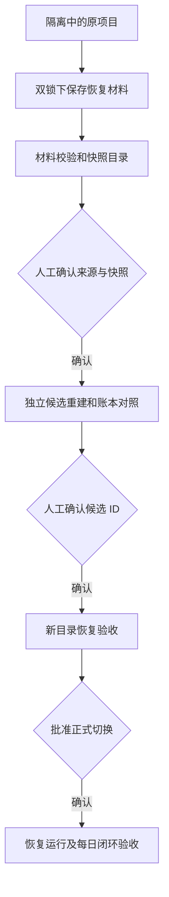

# Operational Recovery and Daily Reliability Plan

## Summary

先处理当前项目未完成的行情批次，再验收每日模拟运行闭环。复用已有恢复工具，在独立目录保留材料、重建候选和验收；不覆盖原项目、不重置账户。

## Problem Frame

2026-10-04 只读检查发现：行情批次仍为 2026-10-01 的 `updating/fetch`，诊断为 `incomplete_batch`；2026-10-02 每日运行失败在行情更新。两个账户最后估值日均为 2026-09-24，各有 13 个估值点和 12 个收益观察，不能解释为 12 天连续自动运行。

本计划建立时，开发分支已有恢复材料、候选重建和验收工具；P3部分失败留证和提交状态已在P2实现，身份关联及完整运行验收待做。后续U4只读汇总和运行身份关联的最新状态见下方验收表。计划任务启用情况仍因此前读取权限被拒绝而未知，本批未重试读取或修改。

本计划承接 [v1.0 设计 P3](../specs/2026-09-18-v1-design.md) 和 [恢复验收协议](../../恢复验收与研究会话.md)。

---

## Requirements

**Evidence and integrity**

- R1. 在行情锁和模拟盘锁保护下，将配置、行情、数据库及更新摘要独立复制至全新材料目录；复核原文件内容未变。
- R2. 校验材料清单、SHA-256、数据库账本结构及事件审计，保留原隔离状态；WAL、链接、锁冲突或账本异常不得被跳过。
- R3. 从材料副本列出原始快照的来源、标的、日期、行数、复权、单位、指纹和校验结果，不自动将最新文件认定为可信来源。

**Recovery approval**

- R4. 人类为每个配置标的确认一份原始快照后，才生成绑定材料 ID 和 SHA-256 的选择清单并重建独立候选。
- R5. 候选及恢复验收必须保持五张账本表内容、事件哈希、现金、份额和权益不变；不推进模拟账户。
- R6. 人工确认候选 ID 后，才在另一个新目录进行恢复验收；实际根目录及计划任务切换需单独批准。

**Daily reliability**

- R7. 后续状态汇总区分本次失败、最后成功、最后账本估值和报告状态，未知信息不得填零或改为成功。
- R8. 正式恢复后验证重复执行不重复记账、上游失败不推进、报告失败不回滚已提交账本；不把离线恢复当作今日联网成功。

---

## Global Constraints

- 本项目用于金融学习与研究，不连接券商，不自动交易，不构成投资建议。
- 原始数据只能新增快照，不能静默覆盖或手工修改。
- 数据源失败时应明确报告，不得编造或补齐真实行情。
- 任何负现金、非整数份额或对账差异都必须中止报告。
- 未解释归因残差超过 `1e-6` 元必须阻断相关报告或提交。
- 不删除隔离标记，不强制忽略 WAL，不迁移真实旧账本，不重置账户。
- 不安装、禁用或修改计划任务，不改系统环境变量，不自动提交、推送、合并或发布。
- 真实材料保存在仓库外的工作区目录，不上传个人行情、账本或日志。

---

## Key Technical Decisions

- **先保留现场，再恢复。** 使用 `recovery.prepare_recovery` 的既有双锁、独立复制和清单协议；源目录仅允许既有锁文件的正常使用，业务文件字节必须保持不变。
- **审计副本，不把审计当作修复。** 复核材料使用只读 `verify_recovery(..., record=False)`；CLI 复核会写材料自己的检查文件，但不写原项目。
- **材料不是完整项目备份。** 保存范围是 `config/**`、`data/**`（排除两把锁）及 `outputs/update_summary.json`；不包含代码、环境、自动化归档或其他报告。
- **选择与切换分离。** 快照目录中的文件名和时间只能辅助筛选；来源、快照选择、候选 ID 和正式切换分别留有确认点。
- **先复用，再扩展。** 当前阶段不新增恢复框架；每日状态汇总在恢复材料验证后形成独立设计与测试，不顺带修改成交模型。

---

## High-Level Technical Design

任何校验失败均保留现场并停止该步骤；不通过删除状态标记返回正常流程。

---

## Implementation Units

### U1. Preserve and Verify the Actual Incident

- **Goal:** 形成当前真实故障的可核验恢复材料，不改变原业务数据。
- **Requirements:** R1、R2。
- **Dependencies:** 无；源项目没有无法解释的 WAL 或持锁冲突。
- **Files:** 使用 `src/finance_lab/recovery.py`、`paper_store.py`、`cli.py`；回归范围 `tests/test_recovery.py`、`tests/test_recovery_ledger.py`。
- **Approach:** 核对当前隔离状态和关键文件指纹；创建源项目外全新目录，准备材料并独立复核；对比来源前后指纹、材料 ID、账本表与事件数量。
- **Test scenarios:** 未完成批次可保存且保持隔离；非空账本只读审计；原业务文件不变；锁冲突/WAL/链接被拒绝；清单篡改被检出。
- **Verification:** 材料 `ok=true`、`copy_integrity=verified`、`ledger_audit.status=passed`，保留预期两账户、事件数、末事件哈希、现金/份额/权益；`ready_for_use=false` 且原隔离状态相同。原数据库、正式行情、状态、配置和更新摘要内容指纹相等。最后估值日及观察数另从副本只读查询，不由审计字段推测。

### U2. Produce an Explicit Snapshot Catalog

- **Goal:** 给出可供人工选择的快照证据，避免隐式选择来源。
- **Requirements:** R3、R4。
- **Dependencies:** U1。
- **Files:** 材料目录中的 `snapshot/data/raw` 与 `recovery_manifest.json`；独立本地快照目录报告，不进入 Git。
- **Approach:** 清点材料清单中的全部原始快照，核对规范字段、标的、来源与目录一致性、不复权、单位、采集时间、日期范围、OHLC/重复日期及 SHA-256。最近快照仅作各来源摘要；错误文件仍列出。报告保存在材料包及 `snapshot/` 之外，不输出逐行行情或自动生成正式选择。
- **Test scenarios:** 多来源分别列出；空或不兼容快照标为不可选；日期覆盖不足不能标为完整；没有记录在材料清单的文件不得进入选择；所有配置标的需各选一份。
- **Verification:** 可定位到材料中的精确路径和清单指纹；每个建议写明来源及截至日；到人工确认处停止，不运行候选重建。

### U3. Build and Accept an Approved Candidate

- **Goal:** 用确认的快照证明恢复项目的行情及模拟账本一致。
- **Requirements:** R4、R5、R6。
- **Dependencies:** U2 和人类快照确认；恢复验收另需候选 ID 确认。
- **Files:** 使用 `src/finance_lab/recovery_rebuild.py`、`recovery_activation.py`；测试 `tests/test_recovery_rebuild.py`、`tests/test_workspace_acceptance.py`。
- **Approach:** 选择清单绑定材料 ID；候选、材料、验收目录不互相嵌套；验收保留离线恢复标记及原证据。
- **Test scenarios:** 错误材料 ID/文件指纹拒绝；行情表与 Parquet 对照；非空账本五表指纹保留；复制或验收中断继续隔离；错误候选 ID 不创建可用项目。
- **Verification:** 候选和验收复核通过，原现场未变；离线摘要不冒充最新行情；正式项目与计划任务尚未切换。

### U4. Complete the Daily Status Contract

- **Goal:** 让本次失败、最后成功、行情身份和账本状态能在同一只读结果中解释。
- **Requirements:** R7。
- **Dependencies:** U1；需独立小型设计及失败测试后实施。
- **Design checkpoint:** [独立只读状态设计](../specs/2026-10-04-paper-operational-status-design.md)经用户直接执行授权后，已按[详细计划](2026-10-04-first-third-execution.md)实施，完成[本地验收](2026-10-04-first-third-acceptance.md)。
- **Files:** 新增 `src/finance_lab/paper_operational_status.py`、`paper_automation_history.py`、`operational_status_io.py` 及对应测试；`market_data_state.py` 增加纯解析入口。原自动化、流水线、账本写入模块未修改，纳入完整回归。
- **Approach:** 复用现有归档和事件事实来源，核验版本与运行身份，区分最后成功日期和最后估值日期；不因为 latest 失败而丢失旧成功，也不把旧成功覆盖到本次状态。独立只读入口不调用会生成报告的 `paper-status`，不补建目录或锁；旧归档缺少的新字段明确为未知。运行身份贯通由后续[独立小批次](2026-10-05-run-identity.md)实施，不改幂等账本 ID。
- **Test scenarios:** 目录没有可见成功归档（不推断从未运行）；成功后失败；报告失败但账本已提交；归档损坏/未知版本；账本不可用；隔离状态下仍可只读说明；历史补处理不算连续自动运行。
- **Verification:** 定向与全量测试通过；合成根的汇总重复读取无变化，本批实施前后原业务文件指纹不变（未对真实根调用新命令）；P3 仅按已验收范围更新状态。

### U5. Validate Actual Resumption

- **Goal:** 在获批的正式根目录完成每日运行及重复执行验收。
- **Requirements:** R6、R8。
- **Dependencies:** U3、U4；人类批准根目录切换及必要的联网运行；计划任务修改独立批准。
- **Files:** `scripts/run_paper_daily.ps1`、`src/finance_lab/paper_automation.py`、实际运行归档和事件账本。
- **Approach:** 先核对来源可用性与日历覆盖，再记录一次完整运行及无新日期重复运行；保留断网、锁冲突和报告失败的隔离测试证据。
- **Test scenarios:** 完整成功；重复 no-op；部分来源失败；陈旧/日历超范围；账本提交后报告失败；未知提交状态；恢复前后历史事件一致。
- **Verification:** 本次状态可信、账本无重复；真实运行次数由归档记录，收益样本由事件记录，二者不混称。

工具子项已按[2026-10-06 区间验收计划](2026-10-06-run-acceptance.md)实施：运行前只读 capture，运行后完整归档区间与全库新增 run 集合对照，以及末次同日期 no-op 核验。隔离合成演练和真实正式运行分别记账；前者通过不表示本节真实恢复目标完成。详见[工具交付记录](2026-10-06-run-acceptance-report.md)。

---

## Approval Gates and Deferred Work

U1–U3 已在对应人类确认后完成；用户随后明确授权按计划直接实施 U4，本地实现与验收已完成。U5 的正式切换、必要联网运行和计划任务操作仍须分别确认，不能将本轮只读实现授权解释为这些操作的批准。

后续工作台 P4、v1.0 发布 P5、推广、新策略和分钟行情不进入本批。已有 PR #13 是否合并单独处理。

## Risks and Dependencies

材料校验失败不等于源账本已经损坏；须先定位结构/事件/文件异常。进程终止的具体原因无法从 `updating/fetch` 标记单独推断。计划任务读取曾被拒绝，本批不绕过权限；启用状态保持未知。

原始快照可能缺少公司行动或近期交易日。历史快照仅用于恢复整理数据，不生成新增模拟观察、不证明来源今日可用。

## Execution Status (2026-10-06)

| Unit | Status | Verified scope |
|---|---|---|
| U1 | 已完成 | 真实材料保存、原业务文件指纹保留、两账户 56 条事件审计通过；材料保持隔离。 |
| U2 | 已完成 | 43 份原始快照全部核对；人工批准 BaoStock 指数和 AKShare ETF 的指定快照，均覆盖 2018-01-02 至 2026-09-30。 |
| U3 | 已完成 | 指定候选重建后，经人类确认完整候选 ID，在独立新目录完成离线验收；行情 4,246 行、五张账本表内容不变，独立复核通过。 |
| U4 | 已完成（本地实现与验收） | 独立只读入口、严格归档/行情语义校验和只读账本审计完成；10月4日全量1033 passed / 4 skipped，独立交叉验证及修复复审通过；后续身份关联见独立行。 |
| 运行身份关联 | 已完成（本地实现与验收） | schema2尝试身份及实际提交收据，明确完整/部分/无新增/未知；旧schema1兼容、同只读事务精确核对历史引用。全量1062passed/4权限skip，独立复审及25场景/75子进程通过。见[计划](2026-10-05-run-identity.md)及[验收记录](2026-10-05-run-identity-acceptance.md)，不代表正式恢复或整个P3完成。 |
| U5 | 区间验收工具与隔离合成演练已完成；真实正式运行未完成 | [计划](2026-10-06-run-acceptance.md)和[工具验收](2026-10-06-run-acceptance-report.md)：只读五表历史基线、全部新归档精确关联、未归档提交检出、末次同日 no-op。正式根目录切换、联网运行及真实重复执行未进行；计划任务不变。 |

U3 两阶段回归分别为候选测试 42 项通过、独立验收测试 21 项通过（两阶段测试范围重叠，不计作 63 个独立测试）。新验收副本的活动状态为 `completed/commit`，凭据标注 `offline_recovery`；摘要保持 `partial_sources`，数据健康保留不复权及离线来源提示。原项目和候选仍保留隔离标记；验收副本可读不等于正式项目已恢复运行。

材料及验收副本不包含历史自动化归档；归档在新目录缺失不能推断“从未运行”，U4 必须明确来源与未知状态。公开健康生成入口会触碰行情锁，U4 的严格只读入口不能直接调用它。当前检查日期会影响健康及陈旧提示，但不改变相同整理文件的 dataset ID。
